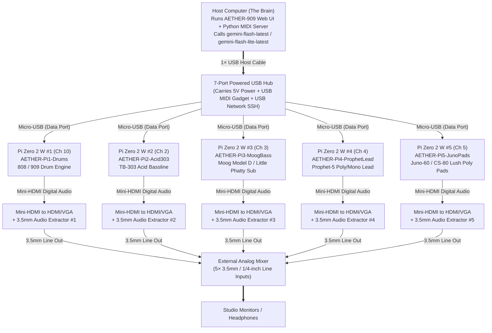

# AGENT HANDOVER SPECIFICATION: AETHER-909 & 5× Raspberry Pi Zero 2 W Headless Hardware Synth Studio

> [!IMPORTANT]
> **Instructions for the Receiving AI Agent**:
> The user is handing this specification to you on a machine where they are plugging in **5× Raspberry Pi Zero 2 W** boards (and/or SD cards for flashing). Your job is to help the user flash, provision, and run these 5 Raspberry Pi Zero 2 W boards as **5 independent, headless, plug-and-play USB-MIDI hardware synthesizers**, controlled by a central AI MIDI Sequencer & Conductor (**AETHER-909**).
> Read this entire document carefully before running commands. Follow all model, audio, and hardware constraints strictly.

---

## 1. Executive Summary & Project Vision

### What We Are Building
We are building a physical, modular, AI-conducted electronic music studio (**AETHER-909**) where a host computer ("The Brain") generates, arranges, and evolves multi-bar electronic music in real time and sends **hardware MIDI Notes, MIDI Continuous Controllers (CCs), and MIDI Program Changes (patch switches)** over USB to **5 physical stand-in synthesizer boxes** whose analog audio outputs sum into an external **physical analog mixer**.

### Why 5× Raspberry Pi Zero 2 W Boards?
1. **The "Modular Swap-Out" Strategy**:
   - Real vintage/modern hardware synthesizers (Roland TR-808/909, TB-303, Moog Little Phatty/Minitaur, Sequential Prophet-5/'08, Roland Juno-60/CS-80) cost $5,000–$15,000+ for a 5-unit rig.
   - Instead of running 5 plugins inside one computer's internal stereo bus, we use **5× Raspberry Pi Zero 2 W** boards as dirt-cheap physical stand-ins.
   - **1 Raspberry Pi Zero 2 W = 1 Dedicated Physical Synthesizer** with **USB MIDI In** (plus power on the same cable) and **3.5mm Stereo Line-Out** going to its own physical channel on an analog mixer.
   - Whenever the user buys a real hardware synthesizer in the future (e.g., a real Moog Minitaur or Roland TB-03), they simply **unplug one Pi Zero 2 W from the USB hub and mixer, and plug the real hardware synth into the exact same USB port and mixer channel**.

---

## 2. Strict Architectural & AI Model Rules (DO NOT VIOLATE)

1. **Gemini Model Selection (`gemini-flash-latest` & `gemini-flash-lite-latest` ONLY)**:
   - When calling the Google Gemini API (`https://generativelanguage.googleapis.com/v1beta/models/{model}:generateContent`) to interpret natural-language music prompts, evolve sections, choose patches, and set synth CC macro targets:
   - **ALWAYS use `gemini-flash-latest` or `gemini-flash-lite-latest`**.
   - **NEVER** use outdated `gemini-1.5-*` or `gemini-2.5-*` model strings, and **do NOT** use a `pro` model (unnecessary latency and cost for real-time bar-boundary music arrangement).
   - Pair the cloud LLM (`gemini-flash-latest` / `gemini-flash-lite-latest`) with a **local `<1ms` Symbolic Music Theory Engine** so the 16-step sequencer clock never stutters while awaiting an HTTP response, applying LLM arrangement/CC/voice-staging updates seamlessly on bar boundaries.

2. **Dynamic Voice Staging — NEVER Play All 5 Synths Non-Stop (Especially the TB-303 Acid!)**:
   - Having all 5 synthesizers playing simultaneously 100% of the time sounds cluttered and fatiguing.
   - **The TB-303 Acid Problem**: A squelchy 303 acid line gets "long in the tooth" very quickly if it plays continuously.
   - **Mandatory Staging Rule (`activeVoices`)**:
     - Stage only **2 to 4 synths active at a time** across song sections (`INTRO` → `GROOVE` → `TENSION BUILD` → `PEAK EUPHORIA` → `DUB BREAKDOWN` → `OUTRO`).
     - Keep the **TB-303 Acid (`Unit 2 / Ch 2`) RESTING (silent/muted)** by default in non-acid genres (*Blade Runner CS-80*, *Stranger Things 80s*, *French House*, *Floating Ambient*, *Aphex Braindance*).
     - Even in *Berlin Dub Techno* or *Warehouse Acid*, keep the 303 **RESTING** during the `INTRO`, `GROOVE`, and `DUB BREAKDOWN`, bringing it in **only** during `TENSION BUILD` and `PEAK EUPHORIA` (or when the user's prompt explicitly asks for `"acid"` / `"303"` or the user clicks a manual **`PIN`** override button in the UI).

3. **Full MIDI CC Parameter Automation + MIDI Program Change (`0xC0`)**:
   - The AI Conductor does not just send `Note On` (`0x90`) and `Note Off` (`0x80`).
   - It continuously morphs synthesizer parameters (Filter Cutoff, Resonance, Envelope Modulation, Decay, Drive, Chorus, Attack, Release, Sub Oscillator Level) by transmitting **MIDI CC (`0xB0 | ch, cc_num, val_0_to_127`)** over USB MIDI to each Pi.
   - When genres or sections change, it sends **MIDI Program Change (`0xC0 | ch, program_0_to_127`)** to switch presets on the synths.

4. **No Synaptics Coral Board**:
   - Do not include a Coral board in the architecture. The host computer is connected directly to the powered USB hub and calls `gemini-flash-latest` / `gemini-flash-lite-latest`.

---

## 3. Physical Hardware & Wiring Topology (Zero Soldering)



### Physical Port Check for the User & Agent
- **Micro-USB Port on Pi Zero 2 W**:
  - Each Pi Zero 2 W has two micro-USB ports: **`USB`** (inner port, closest to the center/HDMI) and **`PWR IN`** (outer port, closest to the corner).
  - **CRITICAL**: Plug the USB cable from the powered USB hub into the **`USB` (DATA) port**, **NOT** the `PWR IN` port! The `USB` data port both powers the Pi Zero 2 W **and** carries USB OTG Gadget MIDI + SSH over a single cable.
- **Audio Output (Zero-Solder Mini-HDMI Audio Extractor)**:
  - Each Pi Zero 2 W outputs 48kHz stereo PCM audio out of its **Mini-HDMI port** into an **HDMI-to-VGA + 3.5mm Audio Extractor Adapter** (with no monitor connected to the VGA side).
  - Because no monitor is attached to the VGA output, `/boot/firmware/config.txt` **MUST** force HDMI hotplug and HDMI audio drive mode (see Section 5 below), or else the Pi will mute HDMI audio thinking no display is connected!

---

## 4. The 5 Synth Assignments, MIDI Channels & CC Maps

Each Pi Zero 2 W runs **Raspberry Pi OS Lite (64-bit, Bookworm)** headless and launches a lightweight ARM64 Linux synth engine bound to its assigned MIDI channel and CC map:

| Unit # | Hostname & USB MIDI Name | MIDI Ch | Instrument Role | Recommended Headless ARM64 Linux Synth Engine | MIDI CC Map (Standardized with AETHER-909) |
| :--- | :--- | :--- | :--- | :--- | :--- |
| **Pi #1** | `pi-drums.local`<br>`AETHER-Pi1-Drums` | **Ch 10** *(0-idx 9)* | **TR-808 / TR-909 Rhythm** | **`fluidsynth`** (`fluidsynth -is -a alsa -m alsa_seq -g 1.0 -r 48000 -c 2 -z 128`) loading a high-punch 808/909 `.sf2` SoundFont + real-time ALSA CC filter/drive wrapper | `CC 20`: Kick Punch/Tune<br>`CC 23`: Kick Decay<br>`CC 26`: Snare Snappy<br>`CC 61`: Hat Decay (`CC 74` Filter)<br>`CC 80`: Drive<br>`CC 7`: Master Level |
| **Pi #2** | `pi-acid.local`<br>`AETHER-Pi2-Acid303` | **Ch 2** *(0-idx 1)* | **Roland TB-303 Acid Line** | **`amsynth`** (`amsynth --headless`) or **`jalv`** running `nekobee` / `So-404` / custom 303 LV2 (monophonic legato slide + velocity > 100 accent filter boost) | `CC 74`: Cutoff Freq<br>`CC 71`: Resonance<br>`CC 19` (`12`): Env Mod<br>`CC 16` (`75`): Decay<br>`CC 81`: Overdrive<br>`CC 85` (`7`): Level |
| **Pi #3** | `pi-moog.local`<br>`AETHER-Pi3-MoogBass` | **Ch 3** *(0-idx 2)* | **Moog Model D / Little Phatty Sub Bass** | **`bristol`** (`startBristol -mini -alsa -midi seq -channel 3 -headless`) or **`amsynth`** (3-oscillator fat ladder sub-bass bank) | `CC 74` (`19`): Cutoff<br>`CC 71` (`21`): Emphasis/Res<br>`CC 73` (`22`): Filter Contour<br>`CC 79` (`14`): Filter Decay/Detune<br>`CC 19` (`18`): Sub Osc Level<br>`CC 17` (`7`): Volume |
| **Pi #4** | `pi-lead.local`<br>`AETHER-Pi4-ProphetLead` | **Ch 4** *(0-idx 3)* | **Sequential Prophet-5 / Analog Lead** | **`bristol`** (`startBristol -prophet -alsa -midi seq -channel 4 -headless`) or **`amsynth`** / **`helm`** LV2 via `jalv` | `CC 74` (`102`): Cutoff<br>`CC 71` (`103`): Resonance<br>`CC 18` (`104`): LFO/Env Mod<br>`CC 75` (`106`): Decay/Delay<br>`CC 83` (`109`): Release/Reverb<br>`CC 85` (`7`): Level |
| **Pi #5** | `pi-pads.local`<br>`AETHER-Pi5-JunoPads` | **Ch 5** *(0-idx 4)* | **Juno-60 / CS-80 Lush Poly Pads** | **`bristol`** (`startBristol -juno -alsa -midi seq -channel 5 -headless`) or **`amsynth`** / **`TAL-NoizeMak3r`** LV2 (6-voice poly pad + stereo chorus) | `CC 74`: Brilliance/Cutoff<br>`CC 93` (`71`): Chorus / Res<br>`CC 73`: Attack<br>`CC 72`: Release<br>`CC 91`: Reverb Wet<br>`CC 7`: Master Level |

> [!TIP]
> **Why `amsynth` + `fluidsynth` + `bristol` (or a unified Python/C++ `pyfluidsynth`/`lv2` host) is great on Pi Zero 2 W**:
> All three are available directly in standard Debian/Raspberry Pi OS `apt` repositories (`sudo apt-get install -y fluidsynth fluid-soundfont-gm amsynth bristol alsa-utils jackd2 jalv`), require zero X11 desktop GUI when run headless, and support full MIDI CC mapping + MIDI Program Change (`0xC0`) out of the box!

---

## 5. Step-by-Step Flashing & Automated Provisioning Guide for the Agent

When the user plugs SD cards (or the 5 Pi Zero 2 W boards) into the computer, follow these exact steps so each Pi boots headless with:
1. **Forced Mini-HDMI Audio Output** (for the HDMI-to-VGA + 3.5mm Audio dongle with no monitor attached)
2. **Unique USB MIDI Gadget Name (`libcomposite`)** so the host computer sees 5 distinctly named hardware USB MIDI devices (`AETHER-Pi1-Drums`, `AETHER-Pi2-Acid303`, `AETHER-Pi3-MoogBass`, `AETHER-Pi4-ProphetLead`, `AETHER-Pi5-JunoPads`) instead of 5 indistinguishable `"MIDI Gadget"` ports!
3. **Auto-started Synth Service + ALSA MIDI Watchdog**

### Step 5.1: Flash Raspberry Pi OS Lite (64-bit) to Each SD Card
Use **Raspberry Pi Imager** (or `rpi-imager --cli` / `dd` with the cached Raspberry Pi OS Lite 64-bit `.img.xz` image) and pre-configure via `cloud-init` / `firstrun.sh` (or mount the `bootfs` partition right after flashing):
- **OS**: `Raspberry Pi OS Lite (64-bit)` (Debian Bookworm)
- **Hostnames**:
  - Card 1: `pi-drums`
  - Card 2: `pi-acid`
  - Card 3: `pi-moog`
  - Card 4: `pi-lead`
  - Card 5: `pi-pads`
- **SSH**: Enabled (with the user's SSH key or username `pi` / password)
- **Wi-Fi**: Pre-configured with the user's local Wi-Fi SSID/password so the agent can SSH into `pi-drums.local`, `pi-acid.local`, `pi-moog.local`, `pi-lead.local`, and `pi-pads.local` to install packages over the internet while the USB port acts as a USB MIDI Gadget!

### Step 5.2: Configure `/boot/firmware/config.txt` & `/boot/firmware/cmdline.txt` on the `bootfs` Partition
Before ejecting each flashed SD card, append the following block to `/Volumes/bootfs/config.txt` (or `/boot/firmware/config.txt`):

```ini
# ============================================================================
# AETHER-909 HEADLESS MINI-HDMI AUDIO + USB OTG GADGET CONFIGURATION
# ============================================================================

# 1. Force HDMI port ON and force HDMI Audio mode even with NO monitor attached
#    (Required for HDMI-to-VGA + 3.5mm Audio Extractor dongles!)
hdmi_force_hotplug=1
hdmi_drive=2
hdmi_force_edid_audio=1
dtparam=audio=on

# 2. Enable DesignWare USB2 OTG Controller in Peripheral/Gadget mode on Micro-USB port
dtoverlay=dwc2,dr_mode=peripheral
```

And in `/Volumes/bootfs/cmdline.txt` (on the single line, right after `rootwait`):
1. Add `modules-load=dwc2,libcomposite`
2. Also add `video=HDMI-A-1:1280x720M@60D` (the trailing `D` forces the newer Bookworm KMS `vc4-kms-v3d` driver to keep the digital HDMI clock and HDMI audio stream active continuously even when the VGA side of the dongle has no monitor connected!).

Example complete `cmdline.txt` addition:
```text
... rootwait video=HDMI-A-1:1280x720M@60D modules-load=dwc2,libcomposite
```

---

### Step 5.3: Create the Custom `libcomposite` USB MIDI Gadget Script on Each Pi
Why use `libcomposite` instead of simple `modprobe g_midi`?
Because `modprobe g_midi` names all 5 Pis `"MIDI Gadget"` with identical USB serial numbers, so macOS/Linux/Windows can't tell which Pi is the 303 and which is the Moog!
With `libcomposite`, each Pi declares its own **exact Hardware Synthesizer Name and Serial Number** over USB!

Install this script at `/usr/local/bin/aether-usb-midi-gadget.sh` (`chmod +x`) on each Pi (setting `SYNTH_ID`, `SYNTH_NAME`, and `MIDI_CH` per Pi):

```bash
#!/usr/bin/env bash
set -e

# Per-Pi Identity (Set during provisioning: 1..5)
SYNTH_ID="${SYNTH_ID:-1}"
SYNTH_NAME="${SYNTH_NAME:-AETHER-Pi1-Drums}"
SERIAL_NUM="AETHER909-000${SYNTH_ID}"

modprobe libcomposite

GADGET_DIR="/sys/kernel/config/usb_gadget/aether_midi"
if [ -d "$GADGET_DIR" ]; then
    exit 0
fi

mkdir -p "$GADGET_DIR"
cd "$GADGET_DIR"

# Linux Foundation Composite Gadget IDs
echo 0x1d6b > idVendor
echo 0x0104 > idProduct
echo 0x0100 > bcdDevice
echo 0x0200 > bcdUSB

mkdir -p strings/0x409
echo "$SERIAL_NUM" > strings/0x409/serialnumber
echo "AETHER-909 Hardware" > strings/0x409/manufacturer
echo "$SYNTH_NAME" > strings/0x409/product

mkdir -p configs/c.1/strings/0x409
echo "USB MIDI Synth Config" > configs/c.1/strings/0x409/configuration
echo 250 > configs/c.1/MaxPower

# Create USB MIDI Function (f_midi)
mkdir -p functions/midi.usb0
echo "$SYNTH_NAME" > functions/midi.usb0/id
echo 1 > functions/midi.usb0/in_ports
echo 1 > functions/midi.usb0/out_ports

ln -s functions/midi.usb0 configs/c.1/

# Bind to the Pi Zero 2 W UDC (USB Device Controller)
UDC_DEV=$(ls /sys/class/udc | head -n 1)
echo "$UDC_DEV" > UDC
```

---

### Step 5.4: Provision the Synth Engines & Low-Latency ALSA Audio on Each Pi
Once each Pi boots on Wi-Fi (`ssh pi@pi-drums.local`, etc.), run this provisioning setup:

```bash
sudo apt-get update
sudo apt-get install -y \
  alsa-utils \
  fluidsynth \
  fluid-soundfont-gm \
  amsynth \
  bristol \
  python3-rtmidi \
  python3-numpy \
  git
```

#### Force ALSA Default Output to HDMI Audio (`Card 0: vc4hdmi`)
Create `/etc/asound.conf` on each Pi so every synth engine outputs directly to the Mini-HDMI Audio Extractor dongle with a small low-latency hardware buffer:
```ini
pcm.!default {
    type plug
    slave.pcm "hdmi_hw"
}

pcm.hdmi_hw {
    type hw
    card vc4hdmi
    device 0
    format S16_LE
    rate 48000
}

ctl.!default {
    type hw
    card vc4hdmi
}
```
*(Note: Verify the HDMI card name via `aplay -l`; on Bookworm it is `vc4hdmi` or `b1`, and test audio output immediately with `speaker-test -D default -c 2 -t wav`.)*

---

### Step 5.5: Auto-Start Synth + USB MIDI Auto-Connect (`systemd`)
Create `/usr/local/bin/aether-synth-runner.sh` (`chmod +x`) on each Pi. This script:
1. Initializes the `libcomposite` USB MIDI port (`AETHER-Pi1-Drums`, etc.)
2. Launches the assigned synthesizer engine for that Pi
3. Runs a background loop that automatically patches the `f_midi` USB MIDI input port to the synth engine in `aconnect`!

```bash
#!/usr/bin/env bash
/usr/local/bin/aether-usb-midi-gadget.sh

ROLE=$(hostname)

# Start the appropriate headless synth engine based on hostname
case "$ROLE" in
  pi-drums*)
    # Unit 1: Ch 10 Drums
    fluidsynth -is -a alsa -o audio.alsa.device=default -m alsa_seq \
      -g 1.2 -r 48000 -c 2 -z 128 \
      /usr/share/sounds/sf2/FluidR3_GM.sf2 &
    SYNTH_CLIENT_MATCH="FLUID Synth"
    ;;
  pi-acid*)
    # Unit 2: Ch 2 TB-303 Acid Bassline (amsynth in mono acid mode on Ch 2)
    amsynth --headless -a alsa -m alsa -c 2 &
    SYNTH_CLIENT_MATCH="amsynth"
    ;;
  pi-moog*)
    # Unit 3: Ch 3 Moog Sub Bass
    amsynth --headless -a alsa -m alsa -c 3 &
    SYNTH_CLIENT_MATCH="amsynth"
    ;;
  pi-lead*)
    # Unit 4: Ch 4 Prophet / Analog Lead
    amsynth --headless -a alsa -m alsa -c 4 &
    SYNTH_CLIENT_MATCH="amsynth"
    ;;
  pi-pads*)
    # Unit 5: Ch 5 Juno / CS-80 Lush Poly Pads
    amsynth --headless -a alsa -m alsa -c 5 &
    SYNTH_CLIENT_MATCH="amsynth"
    ;;
  *)
    amsynth --headless -a alsa -m alsa -c 1 &
    SYNTH_CLIENT_MATCH="amsynth"
    ;;
esac

# Auto-connect USB Gadget MIDI Input (f_midi) -> Synth ALSA Sequencer Port
while true; do
  GADGET_PORT=$(aconnect -i | awk '/f_midi|AETHER/ {print $2}' | tr -d ':' | head -n 1)
  SYNTH_PORT=$(aconnect -o | grep -i "$SYNTH_CLIENT_MATCH" | awk '{print $2}' | tr -d ':' | head -n 1)
  if [ -n "$GADGET_PORT" ] && [ -n "$SYNTH_PORT" ]; then
    aconnect "${GADGET_PORT}:0" "${SYNTH_PORT}:0" 2>/dev/null || true
  fi
  sleep 3
done
```

Enable it at boot via `/etc/systemd/system/aether-synth.service`:
```ini
[Unit]
Description=AETHER-909 Headless USB MIDI Synthesizer Service
After=network.target sound.target

[Service]
Type=simple
ExecStart=/usr/local/bin/aether-synth-runner.sh
Restart=always
RestartSec=2
LimitRTPRIO=95
LimitMEMLOCK=infinity

[Install]
WantedBy=multi-user.target
```

---

## 6. Host Computer Software ("AETHER-909" Brain) Overview

The host computer runs the **AETHER-909** web application + local Python MIDI server (`ai-hardware-synth-studio/`):
- **`server.py`**:
  - Zero-dependency Python HTTP + Native OS MIDI server (`http://localhost:8089`).
  - Enumerates all connected hardware USB MIDI destinations (automatically detecting `AETHER-Pi1-Drums`, `AETHER-Pi2-Acid303`, `AETHER-Pi3-MoogBass`, `AETHER-Pi4-ProphetLead`, `AETHER-Pi5-JunoPads`, or any real hardware synths swapped in later).
  - Proxies `/api/ai/compose` to **`gemini-flash-latest`** and **`gemini-flash-lite-latest`**, returning JSON containing `commentary`, `bpm`, `rootNote`, `scale`, `activeVoices` (boolean map staging only 2–4 synths per section and keeping `acid` resting unless appropriate), `programs` (MIDI Program Change `0xC0`), and `macros` (continuous 0.0–1.0 targets for all synth CCs).
  - Exports standard 5-track `.mid` files (`/api/midi/export`).
- **`public/ai-composer.js` (`AIConductorEngine`)**:
  - Instant `<1ms` local music theory engine + hybrid merge with `gemini-flash-latest` / `gemini-flash-lite-latest`.
  - Implements `acidPolicy` (`'off'`, `'rare'`, `'staged'`), `selectActiveVoicesForSection()`, and `selectProgramChanges()`.
- **`public/app.js` & `public/index.html`**:
  - 5-unit hardware rack UI with live rotary knobs showing exact MIDI CC numbers, `ACTIVE` / `AI RESTING` badges, `PIN` override buttons, `DSP+MIDI` vs `MIDI ONLY` toggle (use `MIDI ONLY` when listening to the 5 physical Pi Zero 2 Ws through the external analog mixer!), `CC LEARN SOLO` mode, and a 16-step interactive pattern matrix.
