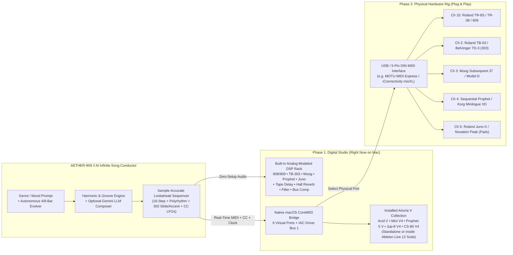

# AETHER-909 // Infinite AI Hardware & Virtual MIDI Synth Studio
## Architectural Evaluation (5 Options) & Digital-to-Physical Hardware Blueprint

---

## 1. The 5 Potential Architectural Options

To build an **ever-evolving, infinite AI-driven electronic music system** that starts 100% digitally on your Mac today (controlling an **808/909 Drum Machine**, **TB-303 Acid Synth**, **Moog Sub/Bass**, **Classic Lead Synth**, **Lush Poly Pad Synth**, and an **Effects Chain**) and transitions with **zero code rewrites** into controlling a table full of physical hardware synthesizers via a USB/DIN MIDI interface, here are the 5 primary architectural paths:

| Option | Architecture | How Sequencing Works | Digital Phase (Now) | Physical Hardware Phase (Later) | Verdict |
| :--- | :--- | :--- | :--- | :--- | :--- |
| **Option 1** | **AI → Physical Hardware Sequencer (SysEx / Pattern Dump)** | App generates patterns & dumps them into an external hardware sequencer (e.g., Elektron Digitakt / Hapax / BeatStep Pro). | Clunky; requires physical sequencer immediately and proprietary SysEx per device. | Hardware sequencer clocks synths, but **cannot smoothly rewrite multi-track notes/CCs in real time** without glitches or pattern-change limits. | ❌ **Eliminated** — As you intuited, programming a physical sequencer from AI adds a bottleneck; the app itself should be the sequencer. |
| **Option 2** | **Inside-Ableton Max for Live (M4L) / Remote Script Sequencer** | Python Remote Script or M4L devices inside Ableton Live 12 mutate Session View MIDI clips. | Tightly integrated with Ableton Live tracks and VSTs. | Requires keeping a heavy DAW open forever; clip-based workflow hides the holistic 5-instrument AI conductor & live hardware telemetry. | ⚠️ **Runner-Up** — Great as a sound host, limiting as the brain. |
| **Option 3** | **Headless Python Terminal Daemon (`mido` / `rtmidi`)** | Command-line Python script running an `asyncio` loop sending MIDI to macOS IAC Driver. | Zero sound unless Ableton is open and 5 tracks are manually configured; `asyncio` sleep can jitter under load. | Works with USB MIDI interfaces, but offers no visual step-grid, no real-time knob feedback, and no tactile human override. | ❌ **Eliminated** — Too opaque for jamming, steering genres, and watching the AI play. |
| **Option 4** | **Pure Browser WebAudio + WebMIDI App** | Browser tab runs lookahead WebAudio clock + WebMIDI API (`navigator.requestMIDIAccess`). | Instant built-in sound + UI, **but browsers on macOS cannot create virtual CoreMIDI ports** or launch local Arturia/Ableton apps. | Works if ports already exist, but lacks native macOS CoreMIDI virtual port creation & OS integration. | ⚠️ **Good Frontend, Incomplete OS Layer** |
| **Option 5 (WINNER)** | **AETHER-909: Hybrid Native CoreMIDI Bridge + WebAudio Lookahead Sequencer + AI Conductor** | **The App IS the Master Sequencer & AI Brain.** Rock-solid lookahead clock drives both an internal Analog-Modeled DSP Rack AND a native macOS `CoreMIDI.framework` Virtual/Hardware Bus simultaneously. | **Works instantly out of the box** (built-in 808/909, 303, Moog, Lead, Pads + FX) **AND** creates 6 real CoreMIDI Virtual Ports + streams to `IAC Driver Bus 1` to control **Ableton Live 12** & **Arturia V Collection** (`Acid V`, `Mini V4`, `Prophet-5 V`, `Jup-8 V4`, `CS-80 V4`). | Plug in any multi-port USB/DIN MIDI interface (MOTU, mioXL, Kenton Thru) and select it in the app's Hardware Routing Matrix. The exact same Channels, Notes, 303 Legato Slides, Accents, MIDI CCs, and 24-PPQN MIDI Clock drive your physical synths. | 🏆 **SELECTED & IMPLEMENTED** |

---

## 2. Why Option 5 Is the Best Architecture

### Key Architectural Advantages
1. **The App IS the Master Sequencer (With True Hardware 303 Legato Mechanics)**:
   - A real TB-303 (or Arturia `Acid V` / Behringer TD-3 / Roland TB-03) triggers a **Slide (Portamento)** when the previous MIDI note's `Note Off` is delayed so it **overlaps** with the next step's `Note On`, and triggers an **Accent** when `Velocity > 100`.
   - Because our app is the sequencer itself, it explicitly computes note overlap (`gate > 100%` on slide steps) and velocity thresholds (`124` on accent steps, `82` on normal steps), alongside real-time MIDI CC messages for Filter Cutoff (`CC 74`), Resonance (`CC 71`), Envelope Mod (`CC 1` / `CC 73`), and Delay/Reverb Sends (`CC 91` / `CC 93`).
2. **You Already Have the Full Arturia V Collection & Ableton Live 12 Suite Installed**:
   - We inspected your `/Applications/Arturia` and `/Library/Audio/Plug-Ins/VST3` directories and found that you already have **`Acid V`**, **`Mini V4`**, **`Prophet-5 V`**, **`Jup-8 V4`**, **`Jun-6 V`**, **`CS-80 V4`**, **`KORG MS-20 V`**, plus Arturia's **`Delay TAPE-201`**, **`Rev LX-24`**, and **`Bus FORCE`** installed alongside **`Ableton Live 12 Suite.app`**!
   - Our app includes a **1-Click Arturia & Ableton Launcher** that opens those exact synths directly from the browser UI and streams live CoreMIDI to them over `IAC Driver Bus 1` and 6 dedicated `AETHER // ...` virtual CoreMIDI ports.
3. **Zero-Setup Internal Analog DSP Rack + Seamless Per-Track Handover**:
   - Even before you open Ableton or Arturia, the app synthesizes all 5 instruments + full Master FX chain internally so you can hear and jam with the AI song immediately.
   - Each of the 5 instrument channels has a **`DSP + MIDI`** / **`MIDI ONLY (External)`** routing toggle, so as you route tracks to Arturia plugins in Ableton (or plug in physical hardware synths one by one), you can mute the internal digital voice for that track while keeping the MIDI output streaming.

---

## 3. Universal MIDI Channel & Hardware Mapping Specification

Both the digital Arturia/Ableton setup and your future physical hardware rig use this standardized MIDI architecture:

| Track / Role | MIDI Channel | Virtual CoreMIDI Port | Installed Arturia Soft-Synth | Target Physical Hardware Synth (Affordable / Classic) | Key MIDI Notes / CCs Sent |
| :--- | :---: | :--- | :--- | :--- | :--- |
| **1. DRUMS (808 / 909)** | **Ch 10** | `AETHER // Ch10 808-909 Drums` | Ableton 808/909 Core Kit | Roland TR-8S / TR-08 / Behringer RD-8 or RD-9 | GM Drum Map: `36` Kick, `38` Snare, `39` Clap, `42` Closed Hat, `46` Open Hat, `37` Rim/Perc, `45/47` Toms |
| **2. ACID (TB-303)** | **Ch 2** | `AETHER // Ch2 TB-303 Acid` | **Arturia Acid V** | Behringer TD-3 / Roland TB-03 / Donner B1 | Mono Notes (`C1–C4`), **Overlapping Note-On/Off for Slide**, `Vel 124` for Accent, `CC 74` Cutoff, `CC 71` Resonance, `CC 75` Decay |
| **3. SUB / BASS (Moog)** | **Ch 3** | `AETHER // Ch3 Moog Sub Bass` | **Arturia Mini V4** | Moog Model D (Behringer Model D) / Moog Minitaur / Bass Station II | Mono Sub/Bass Notes (`C1–G2`), `CC 74` Ladder Cutoff, `CC 71` Emphasis/Res, `CC 1` Mod Wheel |
| **4. LEAD (Classic Synth)** | **Ch 4** | `AETHER // Ch4 Prophet Lead` | **Arturia Prophet-5 V** / **KORG MS-20 V** | Korg Minilogue XD / Sequential Take 5 / Arturia MicroFreak | Lead & Arp Motifs (`C3–C6`), `CC 74` Cutoff, `CC 71` Res, `CC 5` Portamento, `CC 93` Delay Send |
| **5. PADS (Lush Poly)** | **Ch 5** | `AETHER // Ch5 Juno-CS80 Pads` | **Arturia Jup-8 V4** / **Jun-6 V** / **CS-80 V4** | Roland JU-06A / Behringer DeepMind 12 / Dreadbox Nymphes | 4-Voice Poly Chords (Min9, Maj7, Sus4), `CC 74` Filter Sweep, `CC 91` Reverb Send, `CC 73` Attack |
| **MASTER CLOCK & FX** | **Global / Ch 1** | `AETHER // Master Bus (All Ch)` | **Delay TAPE-201** / **Rev LX-24** / **Bus FORCE** | MIDI Clock (`0xF8` @ 24 PPQN, Start `0xFA`, Stop `0xFC`) + Strymon Timeline/BigSky | `CC 16` Master Filter, `CC 17` Tape Delay Feedback, `CC 18` Hall Reverb Mix, `CC 19` Bus Drive |
